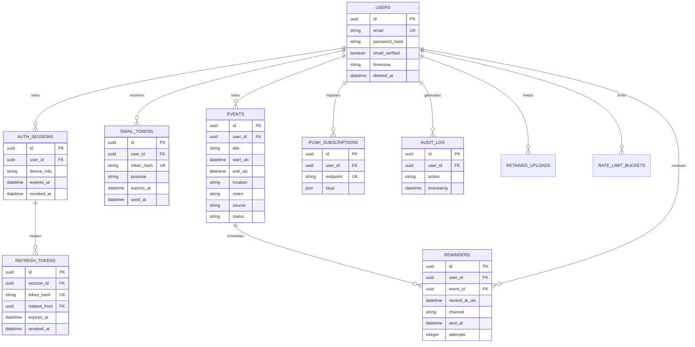

# Event Reminder

A private event calendar that turns screenshots into reviewable event drafts, stores confirmed events in each user's account, and sends reminders. The app includes a React/Vite PWA, FastAPI API, PostgreSQL schema/migrations, a separate reminder worker, Docker Compose, and a Caddy production profile.

## Features

- Private accounts: sign up, email verification, login/logout, logout all devices, password reset/change, profile/time-zone settings, and account deletion.
- Session security: Argon2id passwords; short-lived access and rotating refresh tokens in HttpOnly cookies; refresh reuse detection; CSRF checks; rate limiting; audit log.
- User-scoped event CRUD, duplicate confirmation, search, local-time-zone dashboard, live Today countdowns, and upcoming/past groupings.
- JPEG/PNG/WebP extraction through the backend-only Claude API. The user reviews and edits drafts before saving. Images are not retained by default; opt-in images are sanitized and stored privately.
- Reminder lead times/channels, in-app reminder banner, email and web push delivery, and a separate scheduled worker.
- ICS and JSON export, offline display of cached events, light/dark theme, responsive layouts, and PWA install support.

## Quick start (Docker Compose)

Requirements: Docker Engine and the Compose plugin.

1. Copy `.env.example` to `.env`. Replace `POSTGRES_PASSWORD` with a long URL-safe random string and `APP_SECRET` with at least 32 random bytes. Generate values with:

   ```sh
   python -c "import secrets; print(secrets.token_urlsafe(48))"
   ```

2. Configure SMTP for verification/reset and email reminders. Add `ANTHROPIC_API_KEY` for image extraction and both VAPID keys for web push. These integrations are optional in development.
3. Build and start:

   ```sh
   docker compose up --build -d
   docker compose ps
   ```

4. Open `http://localhost:8080`. OpenAPI documentation is available at `http://localhost:8080/api/docs`; database health is at `http://localhost:8080/api/healthz`. Watch services with `docker compose logs -f api worker`.

Compose starts PostgreSQL, runs Alembic migrations before the API becomes healthy, starts one reminder worker, and serves the frontend with a same-origin `/api` proxy. Data and retained screenshots use private Docker volumes. PostgreSQL and FastAPI ports are not published to the host.

## Manual development

Requirements: Python 3.12, PostgreSQL 15+, and Node.js 22.14+.

1. Copy `.env.example` to `.env`; set a strong `APP_SECRET`, a working `DATABASE_URL`, and `FRONTEND_ORIGIN=http://localhost:5173`. For this mode, the Vite config reads the root `.env`; `VITE_API_BASE_URL` defaults to `http://localhost:8000`.
2. In one terminal:

   ```powershell
   cd backend
   py -3.12 -m venv .venv
   .\.venv\Scripts\Activate.ps1
   python -m pip install -r requirements.txt
   alembic upgrade head
   uvicorn app.main:app --reload
   ```

3. In a second terminal:

   ```powershell
   cd backend
   .\.venv\Scripts\Activate.ps1
   python -m app.worker
   ```

4. In a third terminal:

   ```powershell
   cd frontend
   npm ci
   npm run dev
   ```

   Open `http://localhost:5173`. The `.env` used by the backend is loaded relative to `backend/`; it should remain at the project root.

## Checks

Backend, from `backend/`:

```powershell
pytest
ruff check app tests migrations
alembic upgrade head
alembic check
```

Frontend, from `frontend/`:

```powershell
npm ci
npm run typecheck
npm run build
npm audit
```

Run `pip-audit -r backend/requirements.txt` when auditing Python dependencies. GitHub Actions runs backend tests/lint, a PostgreSQL migration check, both dependency audits, and frontend type-check/build.

## API

The FastAPI application generates OpenAPI at `/openapi.json` (`/api/openapi.json` behind the Compose frontend proxy). Core routes:

| Area | Routes |
|---|---|
| Auth | `POST /auth/signup`, `/auth/login`, `/auth/logout`, `/auth/logout-all`, `/auth/refresh`, `/auth/verify-email`, `/auth/resend-verification`, `/auth/forgot-password`, `/auth/reset-password`, `/auth/change-password` |
| Profile | `GET/PATCH/DELETE /me` |
| Events | `POST /events` (bulk save), `GET /events`, `GET /events/today`, `GET/PATCH/DELETE /events/{id}`, `POST /events/extract` |
| Reminders/push | `GET /reminders`, `POST/DELETE /push/subscribe` |
| Export | `GET /export/ics`, `GET /export/json` |
| Health | `GET /healthz` |

Mutations require the CSRF token returned by `GET /auth/csrf`, sent in `X-CSRF-Token`. Event datetimes require an explicit offset and are stored in UTC. The dashboard and reminder times use the user's IANA time zone.

## Project structure

```text
EventReminder/
├── backend/
│   ├── app/                 # FastAPI routes, security, extraction, reminders, exports
│   ├── migrations/          # Alembic schema revisions
│   ├── tests/               # Auth, isolation, upload, event, DST, reminder tests
│   ├── Dockerfile
│   ├── requirements.txt
│   └── alembic.ini
├── frontend/
│   ├── public/              # PWA manifest, service worker, brand icon
│   ├── src/                 # React routes/screens, API client, offline cache, UI
│   ├── Dockerfile
│   ├── nginx.conf
│   └── package.json / package-lock.json
├── docs/
│   ├── deployment.md
│   └── security-review.md
├── ops/                     # Encrypted PostgreSQL backup/restore scripts
├── .github/workflows/ci.yml
├── .env.example
├── Caddyfile
└── docker-compose.yml
```

## Data model



The ORM models and Alembic revisions in `backend/migrations/` are the authoritative schema, including the user/start-time event index, due-reminder index, and reminder uniqueness/claim fields.

## Security, privacy, and operations

Read [the OWASP-oriented security review and checklist](./docs/security-review.md) and [deployment, TLS, backup, and restore guide](./docs/deployment.md) before exposing the service publicly. The privacy page in the app explains that requested images are sent to Anthropic for extraction; default uploads are processed in memory and discarded. No Anthropic key is sent to the browser.

## Known limitations and next steps

- Verification and password-reset emails use in-process FastAPI background tasks, so a process crash can lose a queued message. A durable encrypted transactional outbox is recommended before production scale.
- Reminder claims, leases, bounded retries, and sent markers prevent ordinary duplicate runs, but a crash after a provider accepts an email/push and before the database commit can still duplicate delivery. True external exactly-once delivery is not guaranteed.
- Morning digest and optional TOTP are not implemented.
- Event notes and location are not application-encrypted. Protect the database with encrypted storage and keep backups encrypted.
- In-app reminder banners appear in the dashboard for recent scheduled in-app reminders. Email, Anthropic, VAPID push, DNS, storage encryption, and monitoring are operator-configured.
- The PWA caches the application shell and the last-loaded event list in this browser's IndexedDB; it does not support offline event writes. Event cache is cleared on sign-out.
- SQLite is used by local backend tests. CI runs migration checks against PostgreSQL, but production-specific PostgreSQL operations should still be exercised in the target environment.
- Replace the starter privacy-policy wording with the operator's contact details, retention policy, and jurisdiction-specific legal language before public launch.
